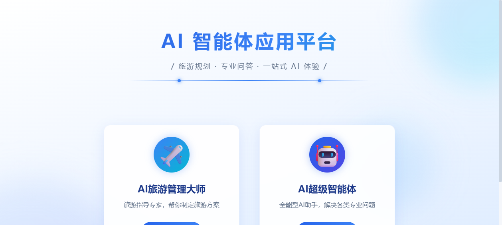
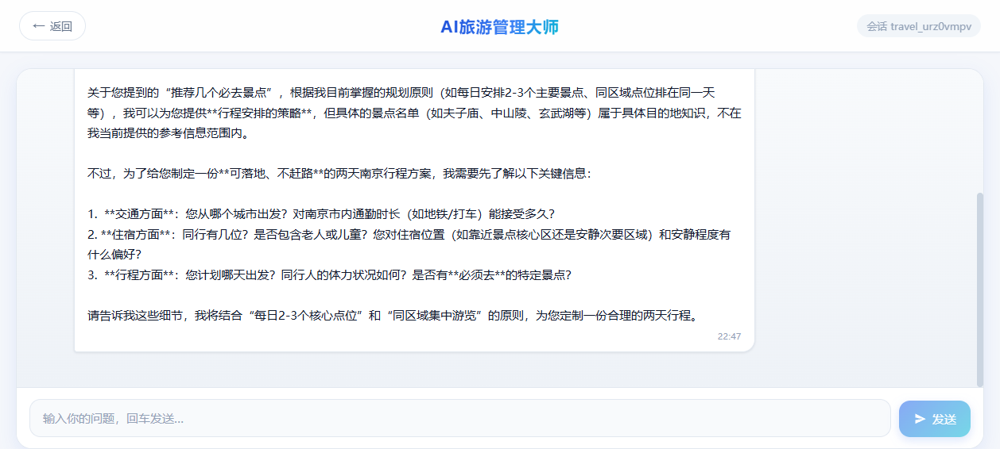
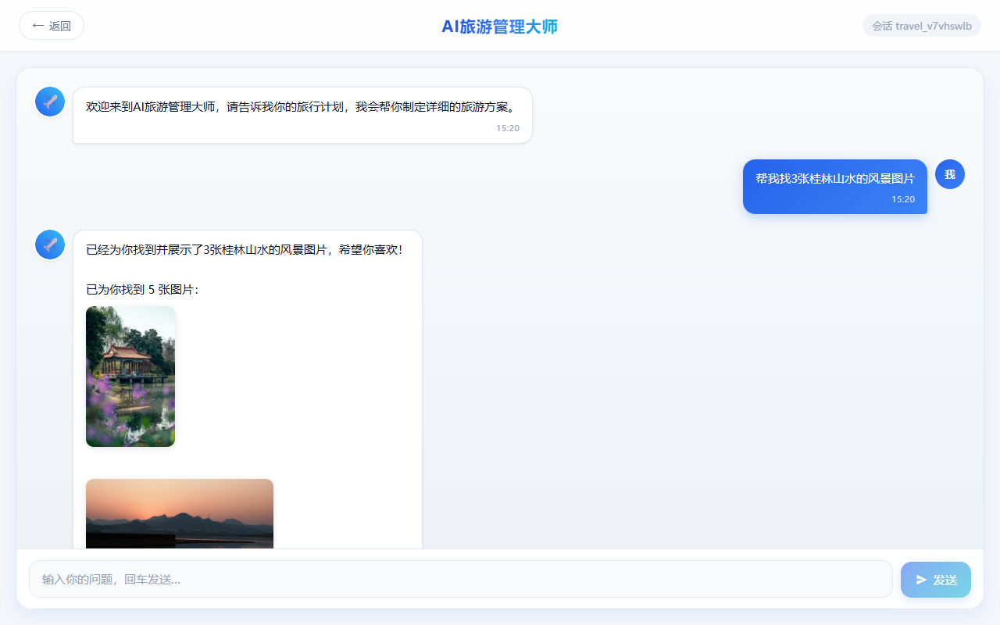

# AI 智能体应用平台

一个基于 Spring AI 的大模型智能体应用，集成 **多轮对话编排、RAG 知识库问答、ReAct 自主智能体、MCP 工具调用** 等大模型工程化的核心技术。提供 Vue 3 聊天界面、Spring Boot 后端，以及一个独立的图片搜索 MCP 服务。

> 项目覆盖 AI 应用开发岗位的核心知识点：模型调用、工具调用（Tool Calling）、RAG 检索增强、Agent 自主规划、MCP 协议、SSE 流式输出。

## 功能特性

平台包含两个智能体，覆盖「垂直领域专家」和「通用全能助手」两类典型场景：

| 智能体 | 定位 | 能力 |
| --- | --- | --- |
| ✈️ **AI 旅游管理大师** | 旅游领域专家 | 多轮对话、RAG 知识库问答、工具调用，模型自主决策回答方式 |
| 🤖 **AI 超级智能体** | 通用全能助手 | ReAct 自主规划，可拆解复杂任务、分步调用工具完成 |

### 核心能力

| 能力 | 实现方式 |
| --- | --- |
| 多轮会话记忆 | `MessageChatMemoryAdvisor` 按 `chatId` 区分会话，保留最近 20 条 |
| RAG 知识库问答 | 文档加载 → Token 切分 → Ollama 向量化 → 查询重写 + 向量检索 |
| 工具调用（8 个） | 联网搜索、网页抓取、文件读写、资源下载、终端操作、PDF 生成、图片搜索、任务终止 |
| ReAct 自主规划 | 手写「思考 → 工具调用 → 结果回填」循环，最多 20 步 |
| MCP 图片搜索 | 独立 Spring AI MCP Server（SSE），主应用 MCP Client 接入 |
| 流式输出 | SSE 逐字推送，前端打字机效果 |
| 图片渲染 | 模型返回的图片链接自动渲染为缩略图 |

## 技术栈

- **后端**：Java 21、Spring Boot 3.4.4、Spring AI 1.0.0、Maven
- **模型与检索**：OpenAI 兼容聊天接口、Ollama `nomic-embed-text`、Spring AI `SimpleVectorStore`
- **前端**：Vue 3、Vue Router、Vite、Axios、EventSource
- **工具与协议**：Spring AI Tool Calling / MCP、Jsoup、iText、Kryo、Knife4j

## 运行效果

**首页 —— 平台入口**



**旅游管理大师 —— 多轮对话 + RAG 知识库问答**



**MCP 图片搜索 —— 大模型通过 MCP 协议调用 Pexels 工具**



## 项目结构

```text
travel-ai-agent/
├─ src/main/java/com/travel/ai/
│  ├─ app/             # 旅游对话应用（ChatClient 编排）
│  ├─ agent/           # ReAct 智能体（BaseAgent → ReActAgent → ToolCallAgent → Manus）
│  ├─ controller/      # HTTP 接口
│  ├─ rag/             # 文档加载、切分、查询重写、向量检索
│  ├─ tools/           # 8 个智能体可调用工具
│  ├─ advisor/         # 自定义 Advisor（日志、Re2 重读增强）
│  └─ chatmemory/      # 文件会话记忆（可选实现）
├─ src/main/resources/document/   # 交通、住宿、行程知识库文档
├─ travel-ai-agent-frontend/      # Vue 3 前端
├─ image-search-mcp-server/       # 图片搜索 MCP 服务（独立模块）
├─ start-all.cmd                  # 一键启动脚本
└─ docs/                          # 文档与截图
```

## 快速开始

### 前置要求

- JDK 21、Node.js、npm
- 可用的聊天模型 API（OpenAI 兼容协议）
- RAG 功能需要本地 Ollama 及 `nomic-embed-text` 向量模型
- 图片搜索需要 Pexels API Key

### 1. 配置密钥

复制 `.env.example` 为 `.env`，填入密钥（`.env` 已被 `.gitignore` 忽略）：

```text
SPRING_AI_OPENAI_API_KEY=你的聊天模型 API Key
SEARCH_API_API_KEY=你的搜索 API Key
PEXELS_API_KEY=你的 Pexels API Key
```

### 2.（可选）启动 Ollama

```powershell
ollama serve
ollama pull nomic-embed-text
```

### 3. 一键启动（推荐）

Windows 下运行：

```powershell
.\start-all.cmd
```

脚本会同时启动主应用后端（`8123`）和图片搜索 MCP 服务（`8127`）。健康检查 `http://localhost:8123/api/health` 返回 `ok` 即就绪。

### 4. 启动前端

```powershell
cd travel-ai-agent-frontend
npm install
npm run dev
```

打开 `http://localhost:3000`。

## 主要接口

以下路径已包含 `/api` 上下文路径：

| 方法 | 路径 | 说明 |
| --- | --- | --- |
| GET | `/api/health` | 健康检查 |
| GET | `/api/ai/travel_app/chat/sync` | 旅游对话（同步） |
| GET | `/api/ai/travel_app/chat/sse` | 旅游对话（SSE 流式） |
| GET | `/api/ai/travel_app/chat/rag` | RAG 知识库问答 |
| GET | `/api/ai/travel_app/chat/tools` | 工具调用对话 |
| GET | `/api/ai/travel_app/chat/mcp` | MCP 图片搜索 |
| GET | `/api/ai/travel_app/chat/unified` | 统一智能体（记忆 + RAG + 工具） |
| GET | `/api/ai/manus/chat` | ReAct 超级智能体 |

示例：

```powershell
# 普通对话
curl.exe -G "http://localhost:8123/api/ai/travel_app/chat/sync" --data-urlencode "message=帮我规划南京两日游" --data-urlencode "chatId=demo-1"

# MCP 图片搜索
curl.exe -G "http://localhost:8123/api/ai/travel_app/chat/mcp" --data-urlencode "message=帮我找3张黄山风景图片" --data-urlencode "chatId=demo-2"
```

接口文档：`http://localhost:8123/api/doc.html`（Knife4j）。

## 架构设计

### 统一智能体（旅游大师）

`/unified` 接口同时挂载多轮记忆、RAG 检索、工具调用，由大模型自主决定响应方式：普通聊天直接回答、需要查资料时检索知识库、需要动手时调用工具。RAG 链路：文档加载 → Token 切分 → Ollama 向量化 → `RewriteQueryTransformer` 查询重写 → `QuestionAnswerAdvisor` 向量检索。

### ReAct 超级智能体

`BaseAgent` → `ReActAgent` → `ToolCallAgent` → `Manus` 四层继承。核心在 `ToolCallAgent`：通过 `internalToolExecutionEnabled(false)` 关闭 Spring AI 内置工具执行，**手写工具调用循环与消息上下文管理**，完整实现「思考 → 工具调用 → 结果回填」的 ReAct 模式。可拆解复杂任务（如「找图并下载到本地」），串联多个工具分步完成。

### MCP 图片搜索

`image-search-mcp-server` 是独立的 Spring AI MCP Server，通过 SSE 传输暴露 Pexels 图片搜索工具；主应用通过 MCP Client 连接并让大模型自主调用。采用「独立服务 + SSE 连接」的双进程架构，是 Spring AI 1.0 的标准 MCP 实践。

### 工具结果格式化

智能体的工具返回原始数据只进入模型上下文，展示给用户的是格式化后的结果：图片搜索输出 Markdown 缩略图、网页搜索输出「标题 + 链接 + 摘要」列表，避免原始 JSON 直接暴露。

## 已知限制

- 多轮会话使用内存存储，服务重启后不保留（文件会话记忆为可选实现）。
- PGVector 持久化、文件会话记忆等为可选扩展，默认未启用。
- 前端 Nginx 配置将 `/api/` 代理到 `127.0.0.1:8123`，容器化部署需调整地址。
- 联网搜索依赖 searchapi.io（免费额度有限）。
